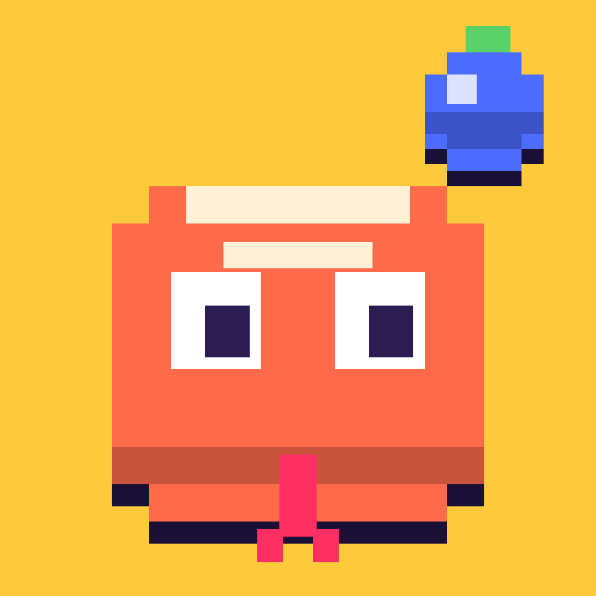

<section class="icl-hero icl-hero--app">

<h1>Snake</h1>

A Snake game with four modes. Eat the blueberries, grow, and keep out of your own way. Steer by tilting, swiping, keys or a gamepad. Your best scores go on a leaderboard on your device.

<a class="icl-button" href="#download">Get Snake</a>
<a class="icl-button icl-button--ghost" href="how-to-play/">How to play</a>

Linux, macOS and Windows &middot; iPhone and iPad to come &middot; English and seven other languages

</section>

<section class="icl-section">

<ul class="sk-facts">
<li><h3>No account</h3>
Open it and play.
</li>
<li><h3>Works offline</h3>
The game does not use the network.
</li>
<li><h3>Stays on your device</h3>
Your name and scores are kept in a file on your device, and nowhere else.
</li>
</ul>

</section>

<section class="icl-section icl-section--tint" id="modes">

<h2>Four modes</h2>
<ul class="icl-points">
<li><h3>Easy</h3>
A slower snake. The walls wrap around, so leaving one side brings you back on the other.
</li>
<li><h3>Classic</h3>
A faster snake. A wall ends the game.
</li>
<li><h3>Portals</h3>
Two pairs of portals on the board. Step into one and come out of its twin. Opens at 2,000 points in Classic.
</li>
<li><h3>Hot potato</h3>
A bomb now and then. Eat it, then shed your tail past it before it goes off. Opens at 3,000 points in Classic.
</li>
</ul>

<a href="how-to-play/">How each mode works</a>

</section>

<section class="icl-section" id="how">

<h2>How it works</h2>
<ol class="sk-steps">
<li><h3>Pick a mode</h3>
Start on Easy or Classic. The other two open as you score.
</li>
<li><h3>Steer and eat</h3>
Eat quickly to build a combo of up to five times the points. The snake gets faster as it grows.
</li>
<li><h3>Beat your best</h3>
A score in the top 10 asks for your name. Each mode has its own leaderboard.
</li>
</ol>

</section>

<section class="icl-section icl-section--tint" id="download">

<h2>Get Snake</h2>
<ul class="sk-cards">
<li><a href="https://github.com/iainchesworthlabs/snake/releases">Linux, macOS and Windows</a>
A package for each, on GitHub. They are pre-releases for now. Each comes with checksums and signatures. The macOS app is not signed or notarised yet, and the Windows files are test-signed.
</li>
<!-- OWNER DECISION: the App Store badge and link go here when the app is live (Apple's artwork, unmodified, and the App Store ID). Until then this is plain text. -->
<li>iPhone and iPad: coming to the App Store
It needs iOS 18 or later.
</li>
<li>Android
The Android package builds, but it has not been tried on a device, so there is no download yet.
</li>
</ul>

The source code is on <a href="https://github.com/iainchesworthlabs/snake">GitHub</a> under the GNU General Public License, version 3 or later.

</section>
