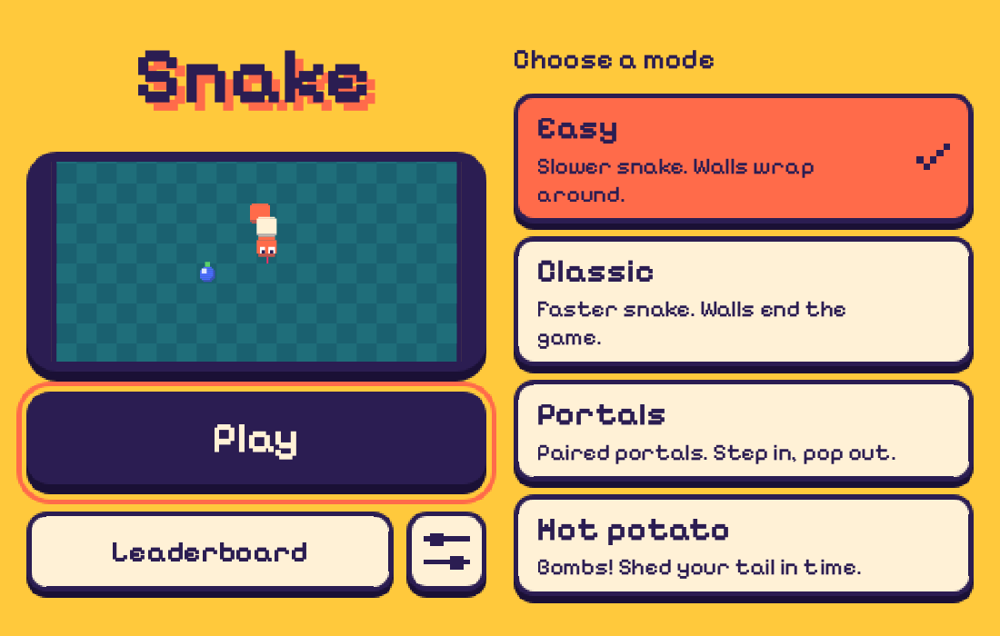
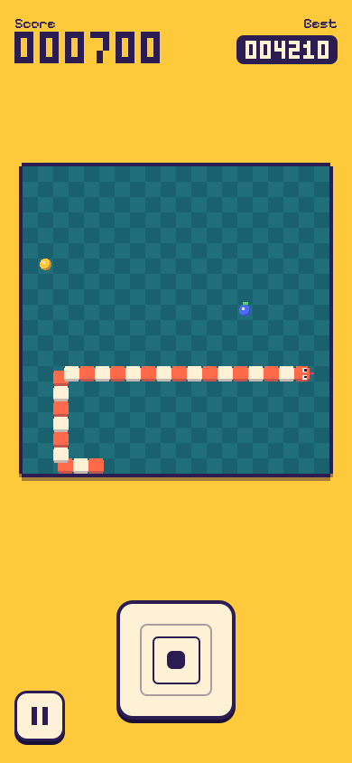
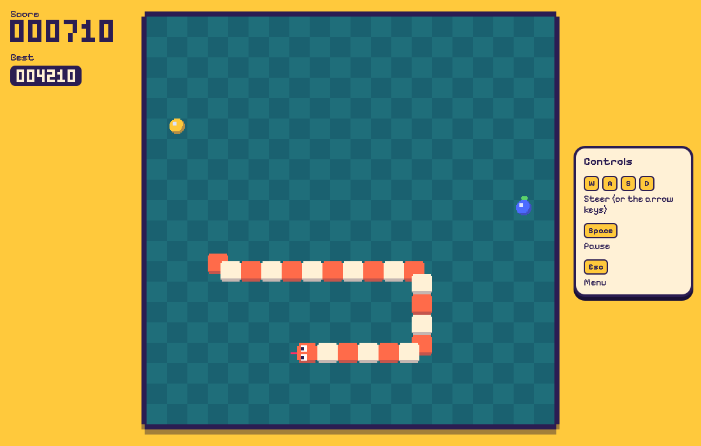
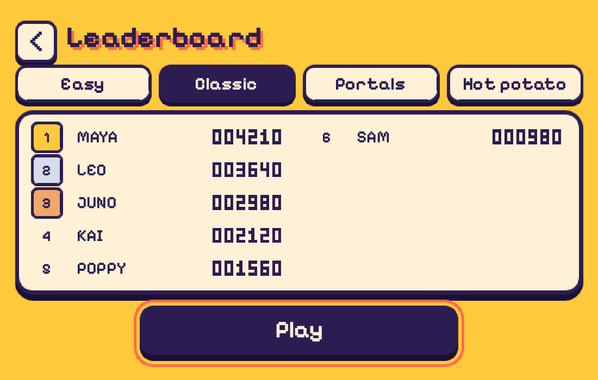
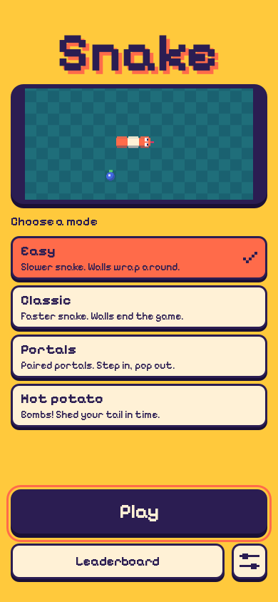
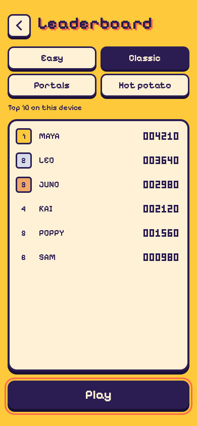

<section class="icl-hero icl-hero--app">

<h1>Snake</h1>

A Snake game with four modes. Eat the blueberries, grow, and keep out of your own way. Steer by tilting, swiping, keys or a gamepad. Your best scores go on a leaderboard on your device.

<a class="icl-button" href="#download">Get Snake</a>
<a class="icl-button icl-button--ghost" href="how-to-play/">How to play</a>

<ul class="sk-platforms" aria-label="Where Snake runs">
<li><strong>Windows, macOS and Linux</strong>Download from GitHub, pre-release</li>
<li><strong>iPhone and iPad</strong>Coming to the App Store, iOS 18 or later</li>
<li><strong>ESP32-P4 board</strong>A hobby build, no download</li>
</ul>

No account &middot; Works offline &middot; Stays on your device &middot; English and seven other languages

<figure class="sk-window"></figure>
<figure class="icl-device"></figure>

</section>

<section class="icl-section" id="modes">

<h2>Four modes</h2>
<ul class="icl-points">
<li><h3>Easy</h3>
A slower snake. The walls wrap around, so leaving one side brings you back on the other.
</li>
<li><h3>Classic</h3>
A faster snake. A wall ends the game.
</li>
<li><h3>Portals</h3>
Two pairs of portals on the board. Step into one and come out of its twin. Opens at 2,000 points in Classic.
</li>
<li><h3>Hot potato</h3>
A bomb now and then. Eat it, then shed your tail past it before it goes off. Opens at 3,000 points in Classic.
</li>
</ul>

<a href="how-to-play/">How each mode works</a>

</section>

<section class="icl-section icl-section--tint" id="how">

<h2>How it works</h2>
<ol class="sk-steps">
<li><h3>Pick a mode</h3>
Start on Easy or Classic. The other two open as you score.
</li>
<li><h3>Steer and eat</h3>
Eat quickly to build a combo of up to five times the points. The snake gets faster as it grows.
</li>
<li><h3>Beat your best</h3>
A score in the top 10 asks for your name. Each mode has its own leaderboard.
</li>
</ol>

</section>

<section class="icl-section" id="screens">

<h2>A look at the game</h2>

These are pictures of the game itself, in its layout for a computer and its layout for a phone. The names on the leaderboards are made up.

<h3 class="sk-gallery__title">On a computer</h3>

<figure>

<figcaption>A game of Classic. The keys are listed beside the board.</figcaption></figure>
<figure>

<figcaption>The leaderboard, a tab for each mode.</figcaption></figure>

<h3 class="sk-gallery__title">On a phone</h3>

<figure>

<figcaption>Choose a mode.</figcaption></figure>
<figure>

<figcaption>Steer by tilting, swiping, a d-pad or a joystick.</figcaption></figure>
<figure>

<figcaption>Your best scores, kept on the device.</figcaption></figure>

</section>

<section class="icl-section icl-section--tint" id="download">

<h2>Get Snake</h2>
<ul class="sk-platform-cards">
<li>

Pre-release

<h3>Windows, macOS and Linux</h3>

A package for each, on GitHub. Each comes with checksums and signatures. The macOS app is not signed or notarised yet, and the Windows files are test-signed.

<a class="icl-button" href="https://github.com/iainchesworthlabs/snake/releases">Packages on GitHub</a>
</li>
<li>
<!-- OWNER DECISION: a photo, or a screenshot taken on a real iPhone or iPad, goes in this card when there is one. None is shown until then: the pictures on this page are of the game running on a computer, in its phone layout. -->

Not out yet

<h3>iPhone and iPad</h3>

It needs iOS 18 or later.

<!-- OWNER DECISION: the App Store badge and link go here when the app is live (Apple's artwork, unmodified, and the App Store ID). Until then this is plain text. -->
Coming to the App Store
</li>
<li>
<!-- OWNER DECISION: a photo of the ESP32-P4X Function EV Board running the game goes in this card when the owner supplies one. No picture is shown until then. -->

Hobby build

<h3>ESP32-P4 board</h3>

The firmware runs on the ESP32-P4X Function EV Board. The board has no accelerometer, so there is no tilt, and its words are in English only. There is nothing to download for it.

<a class="icl-button icl-button--ghost" href="features/#also">About the board version</a>
</li>
</ul>

Android: the package builds, but it has not been tried on a device, so there is no download and Snake is not offered for Android.

The source code is on <a href="https://github.com/iainchesworthlabs/snake">GitHub</a> under the GNU General Public License, version 3 or later.

</section>
