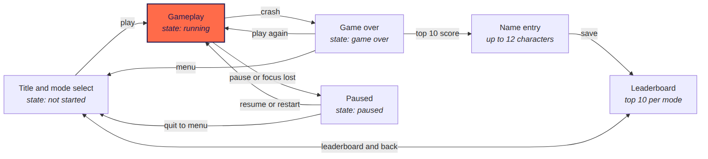

# Snake: Product Requirements

As of 23 October 2026.

## Overview

We are building a polished, retro arcade Snake game that a six-year-old can play and adults will want to replay. It runs on desktop, mobile and an ESP32-P4 handheld, with tilt as the headline control on mobile and the ESP. The repo, language and build infrastructure already exist; this PRD covers rules, controls, presentation and engine requirements for the implementer.

v1 goals:

- Classic Snake rules, implemented exactly and deterministically.
- Smooth, responsive play at a steady frame rate on every target.
- Tilt controls a six-year-old can learn in one game, with touch, keyboard and gamepad alternatives.
- Arcade-style local leaderboards that accept full names.
- An engine that lets later modes (portals, hot potato, ghost runs, rewind) plug in without rework.

The visual design is in `docs/design/` (open `docs/design/index.html`). It is the source of truth for look and layout.

## Platforms and targets

One codebase ships to six platforms, with the ESP32-P4 as the performance floor every feature must clear.

| Platform | Form factor | Primary input | Alternatives | Frame rate target |
| --- | --- | --- | --- | --- |
| iOS, Android phones | Portrait or landscape, full screen | Tilt | Swipe, on-screen d-pad | 60 fps; 120 on high-refresh displays |
| iOS, Android tablets | Portrait or landscape, full screen | Tilt | Swipe, d-pad, gamepad | 60 fps; 120 on high-refresh displays |
| Windows, macOS, Linux | Window or full screen, landscape | Keyboard | Gamepad | 60 fps; match display refresh where higher |
| ESP32-P4 handheld | Landscape panel with touch and accelerometer | Tilt | Touch for menus and pause | 60 fps target, 30 fps floor |

- Phones and tablets play in either orientation, and every screen has a layout for each. The orientation locks for the whole game session on mobile, so tilting never rotates the display; the menus turn with the device.
- A direction change takes effect on the next simulation tick, and rendering adds no more than one frame of delay on top.
- Phones in landscape and tablets in landscape use the wide layout (the ESP's: the board in the middle, the score on one side and the controls on the other); phones and tablets in portrait use the portrait layout.

## Core game rules

The game is classic Snake on a fixed 20 x 20 grid, advanced by a fixed-interval tick, with one rule set shared by every platform.

### Board, snake and food

- **Board:** a square grid of 20 x 20 cells, origin (0, 0) at top left. Cells scale to fit the screen and the board is letterboxed, so a game plays identically everywhere.
- **Snake:** an ordered list of cells, head first. A new game starts with length 3 in the centre, heading right.
- **Direction:** one of up, down, left or right, held until the player changes it.
- **Food:** exactly one item on the board, placed uniformly at random on an empty cell using the game's seeded random generator.

### Each tick, in order

1. Take the next buffered direction, if there is one.
2. Compute the new head cell one step in the current direction.
3. Edges: in Easy, a head that leaves the board wraps to the opposite edge. In Classic, leaving the board is a wall collision and the game ends.
4. Self-collision: the game ends if the new head lands on a body cell. The tail cell counts as free, because it moves away this tick, unless the snake is eating this tick.
5. Eating: if the new head is on the food, add the head, keep the tail, award points and spawn new food. Otherwise add the head and remove the last tail cell.
6. Win: if no empty cell remains to place food, the game ends as a perfect game.

### Direction lock and input buffering

- A reversal is ignored: moving right, a left input does nothing.
- Inputs queue in a buffer of up to two directions, consumed one per tick. Each queued input is checked against the direction the snake will be travelling once the input before it is applied, not the current direction. This stops a fast up-then-left press while moving right from reversing the snake into itself.
- Inputs that repeat the pending direction, or arrive when the buffer is full, are dropped.

### Speed

Tick interval shortens as the snake eats, down to a floor. Starting defaults, to tune in playtesting:

| Mode | Starting tick | Change per food | Fastest tick |
| --- | --- | --- | --- |
| Easy | 180 ms | 2 ms faster | 120 ms |
| Classic | 150 ms | 3 ms faster | 70 ms |

### Game states

The game is always in one of four states: not started, running, paused or game over. The game pauses automatically when the app loses focus, is backgrounded, or the device sleeps. The screen flow under Screens and flows shows the transitions.

## Controls and input

Tilt is the primary control on mobile and the ESP, behaving like a marble on a tray: tip to turn, level out to cruise. Every input method feeds the same direction buffer described under Core game rules.

### Tilt (mobile and ESP)

- **Mapping:** tip the top edge down and the snake heads up; tip the bottom edge down and it heads down; tip the left or right edge down and it heads that way. An inverted-axes setting flips this.
- **Calibration:** at the start of every game, the current device orientation becomes neutral, so players can hold it however is comfortable. Pause > Recalibrate tilt does the same mid-game.
- **Dead zone:** within 12 degrees of neutral on both axes, nothing changes and the snake keeps its heading.
- **Threshold:** tilting past 18 degrees on one axis sets that direction. If both axes are past it, the larger tilt wins.
- **Diagonal stability:** the axis currently in control keeps priority until the other axis is at least 5 degrees larger, so the snake never flickers between two directions.
- **Smoothing:** a light low-pass filter on accelerometer readings removes hand shake without perceptible lag.
- **Feedback:** an on-screen tilt indicator shows the dead zone, the current tilt and the active direction.

All angles are starting defaults to tune in playtesting with the target age group.

### Touch alternatives (mobile)

- **Swipe:** a swipe anywhere on screen sets the direction of the swipe.
- **On-screen d-pad:** optional, for younger players who find swiping fiddly.
- The player chooses Tilt, Swipe or D-pad in Pause > Controls, and the choice is remembered on the device.

### Keyboard and gamepad (desktop, and tablets with a gamepad)

| Action | Keyboard | Gamepad |
| --- | --- | --- |
| Steer | Arrow keys or W A S D | D-pad or left stick |
| Pause and resume | Space | Start |
| Menu | Esc | Select or B |
| Confirm | Enter | A |
| Shed (Hot potato) | Enter | A |

### ESP32-P4

- Tilt steers during play. Touch handles menus, pause and the name-entry letter grid.
- With tilt only, the name-entry grid highlights a key that moves with tilt, and a tap selects it.

### Reserved for later modes

Modes with an action beyond steering (such as firing tail segments) use a shake or screen tap on tilt devices, and Space or a face button on desktop and gamepad.

## Modes

v1 ships two modes, Easy and Classic; every later mode is a combination of mutators on the same engine, not a separate game.

### Mutator architecture

A mode is a named bundle of rule mutators across four layers, plus its own leaderboard and unlock condition:

- **Board:** shape and edges (walls, wrap-around, portals, terrain).
- **Food:** spawning and behaviour (static, timed, moving).
- **Snake:** abilities beyond steering (shedding or firing segments, extra snakes).
- **Time:** rules about history (rewind, ghost replays).

v1 only needs the Board layer (walls versus wrap-around), but all four layers must exist as extension points so later modes add mutators rather than change core rules.

### Mode roadmap

| Mode | What changes | Layers | Phase | Unlock |
| --- | --- | --- | --- | --- |
| Easy | Slower speed curve; walls wrap around | Board | v1 | Always |
| Classic | Rules exactly as under Core game rules | None | v1 | Always |
| Portals | Paired portals move the head to the matching portal | Board | Rules in `libs/sim` (see the roadmap, rule 22) | 2,000 points in Classic |
| Hot potato | Bomb food with a countdown; once swallowed it travels down the body and must be shed before it goes off | Food, Snake | Rules in `libs/sim` (see the roadmap, rule 23) | 3,000 points in Classic |
| Runaway food | Food steps away from the head | Food | Next | To decide |
| Ghost run | A ghost replays your previous run; touching it ends the game | Time | Next | To decide |
| Rewind | Undo the last 3 seconds after a crash, with limited uses | Time | Next | To decide |
| Destructible terrain | Inner walls that shed segments can break | Board, Snake | Later | To decide |
| Parasitic food | A parasite segment eats the tail until shed | Food, Snake | Later | To decide |
| Split brain | Two snakes on one input, one mirrored | Snake | Later | To decide |
| Physics movement | Tilt acts as gravity and the snake has momentum | Snake | Later | To decide |
| Cube surface | The snake crawls over the six faces of a cube | Board, plus a 3D renderer | Later; desktop and mobile only | To decide |

Unlock scores are placeholders to tune in playtesting.

## Scoring, leaderboard and replay hooks

Scores reward fast, clean eating, and each device keeps an arcade-style top 10 per mode with full names.

### Scoring

- **Food:** 10 points, multiplied by the current combo.
- **Combo:** eating again within 20 ticks of the last food raises the multiplier by one, up to x5. Missing the window resets it to x1. The HUD shows the live multiplier.
- **Bonus food:** every fifth food also spawns a bonus item worth 50 points that disappears after 40 ticks. It grows the snake like normal food.
- **Display:** scores show as six zero-padded digits, such as 000420.

All values are starting defaults to tune.

### Leaderboard

- Stored on the device only: a top 10 for each mode, kept across restarts and app updates.
- At game over, a score above zero that beats the 10th entry, or fills an empty slot, opens name entry.
- Names are up to 12 characters of A to Z and space, shown in capitals. Save stays disabled until the name has at least one letter.
- The three most recent distinct names appear as one-tap shortcuts, so young players never retype their name.
- Each entry stores the name, score and date. On a tie, the earlier entry ranks higher.
- Settings offers a reset per mode, behind a confirmation.

### Replay hooks

- **v1:** combo multiplier, bonus food, the speed curve, a game over message showing how many points beat your best, and score-based mode unlocks.
- **Later:** a daily challenge with a shared seed for everyone on the device, and a ghost of your personal best to race.

## Look, feel and polish

The chosen direction is Toybox Pixel: bright, chunky 16-bit pixel art that reads instantly for a six-year-old, rendered smoothly and crisply on modern screens. Machine-readable values are in `design/tokens.json`.

### Visual system

| Token | Hex | Use |
| --- | --- | --- |
| Sunshine | #FFC93C | Screen background |
| Night purple | #2B1D52 | Text, borders, primary buttons, board frame |
| Deep purple | #1A1035 | Hard drop shadows |
| Cream | #FFF1D6 | Panels, secondary buttons, snake stripes |
| Coral | #FF6B4A | Snake, selected states, highlights |
| Board teal | #1F6E7A and #1A6170 | Checkerboard cells |
| Blueberry | #4C6BFF | Food |
| Leaf | #5BD16A | Food leaf |
| Tongue | #FF2E63 | Snake tongue |

- **Type:** Pixelify Sans, weights 400 to 700, bundled with the app (font files are in `design/fonts`). The ESP uses a pre-rendered bitmap version at the sizes it needs.
- **Shapes:** 3 to 4 px purple outlines, hard offset drop shadows, no blurred shadows or gradients.
- **Snake:** coral and cream stripes with a bevel along the bottom of each segment; the head has eyes facing the direction of travel and a flicking tongue.
- **Food:** a blueberry with a leaf that bobs gently.

### Smooth and crisp

- The simulation stays on the grid, but rendering runs at the display's refresh rate and glides each segment between cells, so movement looks fluid while rules stay exact.
- Art scales in whole-pixel steps so edges never blur.

### Feedback and juice

- Eating: a pop, a small particle burst and a floating score.
- Near food: the head reacts as it approaches.
- Death: segments flash, then pop one by one from the tail, with the head showing dizzy eyes; subtle screen shake on impact.
- Sound: chiptune effects and music, each with its own toggle.
- Haptics on phones and tablets for eating and crashing.
- Attract mode: the title screen shows the game playing itself.

### Accessibility

- Text contrast of at least 4.5:1, and touch targets of at least 44 px.
- A reduced-motion setting, defaulting to the device's preference, turns off shake and flashing.
- Colour is never the only signal: selected states also change outline, fill or position.

### ESP rendering tier

The ESP uses the same art with flat fills and hard shadows only, a capped particle count, and no alpha-heavy effects.

## Screens and flows

Eight designed screens cover v1. Screenshots are in `design/screenshots`, clickable versions in `design/screens` (start at `design/index.html`).

| Screen | What it holds | Screenshot |
| --- | --- | --- |
| Title and mode select | Attract-mode preview, Easy and Classic, locked modes with unlock targets, Play, Leaderboard, Settings | [toybox-title.png](design/screenshots/toybox-title.png) |
| Gameplay (phone) | Score, best, mode, combo, board, tilt indicator, pause | [toybox-gameplay.png](design/screenshots/toybox-gameplay.png) |
| Paused | Resume, restart, control choice, recalibrate tilt, sound, music, quit to menu | [toybox-paused.png](design/screenshots/toybox-paused.png) |
| Game over | Frozen crash moment, score, best, points needed to beat best, play again, menu | [toybox-game-over.png](design/screenshots/toybox-game-over.png) |
| Name entry | Live rank, 12 name slots, recent names, letter grid, save | [toybox-name-entry.png](design/screenshots/toybox-name-entry.png) |
| Leaderboard | Easy and Classic tabs, top 10, medal tiles for the top three, latest entry highlighted | [toybox-leaderboard.png](design/screenshots/toybox-leaderboard.png) |
| Desktop gameplay | Landscape, board centred, score on the left, keyboard and gamepad help on the right | [toybox-desktop.png](design/screenshots/toybox-desktop.png) |
| ESP gameplay | Landscape, board centred, score on the left, tilt indicator and pause on the right | [toybox-esp.png](design/screenshots/toybox-esp.png) |
| Settings | Inverted axes, reduced motion, leaderboard reset | Not yet designed |

The diagram source is `design/screen-flow.mmd`.

Pausing never ends a game. Menu on the game over screen returns to the title, and only a top 10 score routes through name entry before the leaderboard.

## Engine and technical requirements

The simulation must be deterministic and fully separate from rendering; these two decisions are cheap now and expensive to retrofit, because rewind, ghosts and replays all depend on them.

### Deterministic simulation

- Fixed-timestep loop: the simulation advances in whole ticks; rendering interpolates between the last two ticks.
- Integer cell coordinates only, with no wall-clock time or floating-point maths inside the simulation.
- A portable seeded integer random generator, so the same seed and the same inputs per tick give an identical game on every platform.
- No heap allocation per tick or per frame in the game loop.

### Separation of concerns

| Component | Responsibility | Knows about |
| --- | --- | --- |
| Simulation core | Rules, state, mutators, random generator | Nothing platform-specific |
| Input adapters | Turn tilt, swipe, d-pad, keys and gamepad into direction events | Platform input APIs |
| Renderer | Draws the current state with interpolation and effects | Simulation state, read only |
| Platform services | Storage, audio, haptics, sensors, app lifecycle | Platform APIs |

### History and replays

- Keep a rolling buffer of recent ticks (at least 10 seconds) as compact snapshots or an input log with periodic snapshots.
- Save the seed and per-tick inputs for the last game and the best game in each mode.
- v1 only records these; rewind, ghost runs and replays use them later.

### Persistence

Store leaderboards, recent names, unlocks and settings (controls, inverted axes, sound, music, reduced motion) on the device, under a versioned schema that survives app updates.

### Testing

- Unit tests for every rule under Core game rules, including the vacating-tail case and the buffered reversal case.
- Golden replay tests: a recorded seed and input log must produce the same final state and score on every platform.
- On-device checks on the ESP for frame rate and tilt feel.

## Acceptance criteria for v1

v1 is done when every item below is checked on all six platforms unless an item names fewer.

- [ ] Every rule under Core game rules has a passing unit test, including the vacating-tail and buffered-reversal cases.
- [ ] A golden replay gives an identical final state and score on Windows, macOS, Linux, iOS, Android and the ESP.
- [ ] Gameplay holds its frame rate target on each platform, with the ESP never dropping below 30 fps.
- [ ] A direction change shows on screen within one tick plus one frame.
- [ ] Tilt calibration, dead zone, threshold and diagonal stability behave as specified, and the screen never rotates during play (mobile and ESP).
- [ ] In a playtest, a six-year-old finishes a game of Easy with tilt after one practice game.
- [ ] Swipe, d-pad, keyboard and gamepad all steer, and the chosen control persists (where each applies).
- [ ] The game pauses automatically when it loses focus, is backgrounded or the device sleeps.
- [ ] Easy and Classic each keep a top 10 with 12-character names and recent-name shortcuts that survive restarts and updates.
- [ ] Locked modes show on the title screen with their unlock targets and cannot be started.
- [ ] The reduced-motion setting removes shake and flashing.
- [ ] Every screen matches the design: title and mode select, gameplay, pause, game over, name entry and leaderboard on phone, plus the desktop and ESP layouts.

## Out of scope, assumptions and open questions

v1 stays local and single-player; the items below need confirming before or during build.

### Out of scope for v1

- Online leaderboards, accounts and cloud sync.
- Multiplayer of any kind.
- Playable modes beyond Easy and Classic, including any 3D rendering.
- The daily challenge and personal-best ghost.

### Assumptions

- The ESP display is a 1024 x 600 landscape panel with touch, plus an accelerometer.
- The board is 20 x 20 on every platform, and a new snake starts with length 3.
- Easy and Classic keep separate leaderboards.
- "Snake" is a working title.
- All tuning values in this document (speeds, tilt angles, combo window, bonus food, unlock scores) are starting defaults for playtesting.

### Open questions

- [ ] Which exact ESP32-P4 board and display will ship, and does it have physical buttons?
- [ ] What is the game's final name?
- [ ] Who produces the sprites, chiptune music and sound effects, or should v1 use placeholders?
